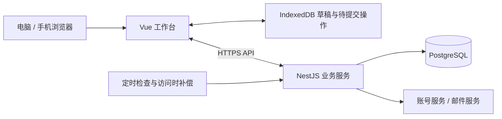

# 四层工作对齐工作台：技术方案

更新日期：2026-10-22。阶段：技术栈与当前功能范围已由用户确认，第一至第六阶段已按授权在本地完成，第六阶段已完成本地验收与交付。用户要求最终打包镜像，GitHub 仓库稍后提供，执行方式由用户决定。阶段成果见[第一阶段](阶段1-验收记录.md)、[第二阶段](阶段2-验收记录.md)、[第三阶段](阶段3-验收记录.md)、[第四阶段](阶段4-验收记录.md)、[第五阶段](阶段5-验收记录.md)及[第六阶段验收记录](阶段6-验收记录.md)。

本方案依据用户提供的 HTML、截图、源码核对及浏览器实际操作。用户补充使用者约 1000 人，首版按“约 1000 名使用者、个人目标管理、账号数据独立、手机电脑使用同一份数据”设计；峰值同时在线人数尚未确认。多人协作、组织权限和 AI 自动拆解属于后续扩展，未视为已确认需求。

## 1. 产品定位与已验证行为

工作台围绕一条完整的工作链路：年度目标 → 月度目标 → 周任务 → 日待办。向下拆解执行，向上追溯每件事服务的目标，按周期复盘完成情况。

实际点击“载入示例”后，得到 4 个年度目标、6 个月度目标、7 个周任务、7 条当日待办，计划投入 235 分钟。示例覆盖财务基础工程、AI 与信息化提效、组织与团队能力、政策与资金等方向；具体业务名称是示例内容，不应写死在产品中。

实测汇总为年度 31%、本月 66%、本周推进 50%、今日完成 0/7。勾选首条日待办后，日进度为 14%、年度归集已完成数增加 1，年/月/周进度保持原值。当前原型并未实现从日待办逐级自动更新上层进度。

年度执行归集统计的是挂在年度目标下面的月、周、日事项；示例共 20 条，年度目标本身不计入这 20 条。不同层级是不同统计对象，20 条不能解释成 20 个独立交付成果。

本次运行使用独立浏览器环境，核验了本地示例、视图切换和待办完成操作。登录、验证码、密码重置、云端权限和真实多端同步仅核对了接入代码，未验证线上服务；测试时隔离了外网访问，页面的离线提示不能据此判定原云服务故障。

## 2. 首版功能范围

| 模块 | 功能 |
| --- | --- |
| 年度目标视图 | 年份切换；目标增删改；衡量标准；手动进度；权重；查看关联的月/周/日事项；按已完成、未完成归集 |
| 月度执行视图 | 月目标卡片、周任务、日待办、今日焦点、四项进度汇总、对齐体检 |
| 月度目标 | 标题、说明、所属月、截止日期、权重、手动进度、关联年度目标 |
| 周任务 | 标题、说明、起止日期、关联月目标；P0/P1/P2；未开始/进行中/受阻/已完成 |
| 日待办 | 标题、执行日期、预计分钟数、完成勾选、关联周任务；显示完整上级链路 |
| 周期选择 | 年/月/周/日联动；本周、上周、下周、月内各周；支持跨月和自定义区间 |
| 自动顺延 | 未完成日事项移入今天、过期周事项移入本周、过期月目标移入本月；提示顺延结果并保留历史 |
| 对齐体检 | 检查月目标未拆周任务、周任务未关联月目标、未完成周任务未安排动作、日待办未关联周任务；汇总当日预计投入 |
| 编辑与保存 | 点击编辑、进度滑块、关联选择、回车连续新增；自动保存；显示保存中/已保存/待同步/冲突 |
| 账号与数据 | 邮箱登录及账号恢复；本地访客模式；登录后的手机电脑同步；旧 JSON 导入、导出、示例与清空 |
| 体验 | 浅色/深色、桌面与手机响应式；可安装网页应用作为交付增强 |

原型已有部分浅色/深色、移动布局和 PWA 引用，但不能仅凭引用认定完整安装与离线能力已经可用。正式交付需要补齐资源并实际验收。

“建议每天 3–5 件事”保留为提示，不作为数量限制；示例本身有 7 件。原型中的 AI 是业务目标名称，未发现模型调用或自动生成任务的实现。

## 3. 推荐技术架构

已确认采用 Vue 3 + TypeScript + Vite 前端，NestJS 模块化单体后端，PostgreSQL 数据库，以及承担访客数据、草稿与待同步操作的 IndexedDB。后端使用 TypeScript 编写，经编译后以 JavaScript 在 Node.js 运行。一个前端应用、一套 API、一个数据库即可覆盖当前需求。

| 层次 | 建议 | 在本项目中的用途 |
| --- | --- | --- |
| 前端 | Vue 3、TypeScript、Vite | 将年度视图、目标卡片、任务行、周期选择、汇总和体检拆成组件；共享明确的数据类型 |
| 界面与状态 | 自定义主题样式、Pinia | 保留参考页面的视觉结构；管理视图、筛选条件和编辑草稿 |
| 后端 | NestJS、REST API | 按账号、目标任务、统计、顺延、导入导出划分模块；统一校验业务规则 |
| 数据库 | PostgreSQL | 保存四层实体及关联、历史记录；事务处理顺延、导入和批量变更 |
| 本地数据 | IndexedDB | 保存访客数据、缓存和待提交操作；localStorage 仅保存轻量偏好 |
| 安装与离线资源 | vite-plugin-pwa | 生成 manifest、注册 service worker、缓存应用静态资源；业务数据同步仍由应用实现 |
| 部署 | HTTPS 反向代理、应用服务、数据库 | 前端与 API 同域部署；提供数据库备份、健康检查和必要的错误日志 |

Vue 官方提供 TypeScript/Vite 工程支持；NestJS 提供按模块组织业务能力；PostgreSQL 的外键、约束和事务适合约束关联与批量变更。这些是本项目的选型依据，具体依赖在实施时选取受维护的稳定版本并锁定。

业务规则由后端执行，前端负责即时展示和必要的预览。浏览器的选中日期、当前标签页等偏好按设备保存，避免手机操作把电脑正在查看的历史月份切走。

原型中的 WorkBuddy Cloud 已有账号和整份状态同步接入。若有该服务的管理权限，可先验证并评估复用账号服务；推荐的数据结构、权限和同步机制仍应落实。无需仅为保留原 SDK 而沿用整份 JSON 覆盖方式。

### 3.1 约 1000 名使用者的容量与部署

Node.js 适合本工作台以数据库读写、网络请求为主的负载。当前规模可以继续采用上述技术栈，但容量必须结合实际请求、数据量和压测确认，不能仅由账号数量推导。

- 总用户数、同时在线数、同时请求数和每秒请求数分别统计。作为算例，100 人同时在线、每人平均 5 秒一次请求，约为 20 RPS；1000 人同时在线且保持相同频率，则约为 200 RPS。两者都不是已测性能，页面多接口、重试和批量同步还会改变请求量。
- API 服务可用 2 vCPU / 4 GB 内存作为首轮压测起点，PostgreSQL 使用独立实例或托管数据库；正式配置根据压测与可用性要求调整。先采用单体服务，后续需要时通过反向代理增加 API 实例。
- 数据库连接使用连接池，按所有进程、实例和后台任务的总连接数预算，并为运维预留连接；不为每名在线用户保持一条数据库连接。扩实例时同步检查连接总量。
- 工作台只查询当前用户与当前范围，历史执行记录分页；统计尽量在数据库内聚合，避免每次操作读取全年全部记录或整份 JSON。按 user_id 与日期/月份/关联键组合建立索引。
- 自动保存按字段提交并防抖，重新联网后的待提交操作限制并发；顺延按用户分批处理。多个实例执行定时任务时，使用数据库锁、条件更新和唯一约束保证只执行一次有效变更。
- CPU 密集处理、大体积 JSON 解析、全量导出等限制单次输入及批量大小；出现明显耗时任务时移入后台执行，避免阻塞 API 的事件循环。

除请求量外还要验证长期数据规模。作为数据量算例，1000 人每天新增 5 条日待办，一年约为 182.5 万条，另有变更日志和快照；压测数据应覆盖至少一个完整年度，而不是只用首页的几十条示例。

容量验收覆盖集中打开首页、连续编辑自动保存、跨月顺延、离线后集中同步与多端冲突，观察 p95 响应时间、错误率、事件循环延迟、CPU/内存、慢查询和连接池等待。以预期峰值及更高一档负载验证余量；1000 人同时在线的场景单独测试，不从注册人数作保证。

## 4. 数据模型

四层业务字段不同，建议使用四张明确的业务表，保留固定的上下级关系。

| 表 | 主要字段 |
| --- | --- |
| users | 账号标识、时区、账号服务映射 |
| annual_goals | 标题、说明、年度、手动进度、权重 |
| monthly_goals | 年度目标 ID、标题、说明、原所属月、当前所属月、截止日、手动进度、权重 |
| weekly_tasks | 月目标 ID、标题、说明、原区间、当前区间、优先级、状态 |
| daily_tasks | 周任务 ID、标题、原计划日期、当前执行日期、预计分钟数、完成时间 |
| schedule_history | 事项类型与 ID、原排期、新排期、原因、发生时间、顺延批次及当时状态快照 |
| activity_logs | 编辑、关联变更、状态变更、删除恢复等操作的前后值 |
| period_snapshots | 封存周期的目标、关联及执行情况，用于历史复盘 |

业务表共同包含：UUID、user_id、version、created_at、updated_at、deleted_at、archived_at。时间戳统一保存 UTC；业务日期使用 DATE；日界线和自然周按用户时区计算，默认 Asia/Shanghai。

年→月、月→周、周→日均是一对多。原型允许未关联事项，首版保留这种能力，由对齐体检提示。关联只能指向同一账号的数据；使用包含账号标识的关联约束或等效的服务端校验，防止跨账号挂接。

删除采用可恢复删除，默认保留下级事项；当前工作视图提示重新关联，历史视图保留删除前的目标链路。不得在删除一个年度目标时静默删除整棵执行记录。

常用查询索引围绕 user_id + 当前年度/月/日期、周区间，以及各级 parent_id 设置。完成时间、版本和操作日志由服务端写入，避免以设备时间判断先后。

## 5. 关键业务规则

### 5.1 进度与完成口径

首版保留原型的口径，并在界面上说明计算方式：

- 年度汇总：所选年度各年度目标进度的权重平均。
- 月度汇总：所选月份各月目标进度的权重平均。
- 周推进指数：未开始 0、进行中 50、受阻 15、已完成 100，取平均；这反映状态指数，不等同于实际工作量完成率。
- 当日完成率：已完成待办数 / 当日待办总数。
- 年/月手动进度与下级完成率分别展示，勾选日待办不直接把整个月目标判为完成。

权重为 0 的项不参与加权；所有权重都为 0 时显示“未设置权重”，不将 0 偷换成 1。原型的 `weight || 1` 会使 0 权重仍参与统计，正式版修正。

可在后续提供“按下级完成率计算”的进度模式；切换模式必须明确，并避免把人工进度与自动进度混成一个数。父项标完成而子项仍未完成时，给出处理入口，由用户决定继续、改挂或结束子项。

今日焦点首版沿用首个未完成待办。原型没有按 P0 自动挑选焦点，也没有 AI 推荐；如增加排序，需作为显式产品规则。

### 5.2 时间区间与查询

原型的周列表要求任务起止日期与所选区间完全相等。因此，选择 10/19–10/25 能看到的任务，切成 10/19–10/26 后可能全部消失。

建议正式版区分“任务本身的排期”和“查看范围”：自然周默认周一至周日；自定义查看范围列出与其相交的周任务，即 task.start <= filter.end 且 task.end >= filter.start。任务显示自身实际区间，单个视图内按 ID 去重；“新增周任务”使用当前选择区间作为初始排期。

这是相对原型的明确改进建议，而非原型已有行为。跨周任务可能出现在多个周视图，但年度或月度汇总须按实体 ID 去重。

月份归属和截止日期分别保存。某项目属于 10 月推进，但截止日期是 12 月，属于合法情况；切换月份筛选不会修改截止日期。

### 5.3 自动顺延与历史

原型会直接覆盖日日期、周起止和所属月；只顺延日/周/月，不顺延年度，也不自动修改截止日。正式版保留任务身份，同时记录排期变更，保证“现在做什么”和“上期原本计划什么”都能查看。

- 日：执行日期早于今天且未完成，移入今天。
- 周：区间结束日早于今天且未完成，移入当前自然周，状态与优先级保持。自定义区间同样按实际结束日判断。
- 月：所属月早于当前月份且进度不足 100%，移入本月，原截止日保留，逾期标记继续显示。
- 已完成、已删除或已归档事项不顺延；受阻事项顺延后仍为受阻。
- 一次进入当前周期即可，无需为离线多日逐日复制同一事项。
- 每次顺延保存原排期、目标排期、关联、进度及发生原因，周期复盘读取封存快照，避免按当前日期回算历史。

跨年时保留原年度来源，明确标记“跨年承接待确认”。用户可继续归属于原年度目标，或显式选择新年度目标；更换关联写入历史，不静默重挂，也不复制累计完成量。

后端定时检查与访问时补偿调用同一套规则；任务变更、日志和周期快照在事务中处理。事务内锁定事项行，或按 version 与过期条件执行原子更新；只有更新成功者写入日志和快照。幂等键包含事项、当前排期版本、目标周期，并设置数据库唯一约束，使多端重复打开和请求重试只产生一次有效顺延。

应用跨天后先提交或保存本地草稿，再更新今天和周期；从云端恢复、导入旧数据后同样重新检查顺延。查看历史期间不强制跳走；仅新会话默认进入今天，并提供“回到今天”。

### 5.4 对齐体检

首版使用确定性规则，无需模型调用。输出应包含问题、对应事项和操作入口，例如“本月目标尚未拆周任务 → 新增周任务并自动挂接”。

在原型规则基础上建议补充：月目标未关联年度目标、上层已完成但下层未完成、跨年关联待确认、截止日期已过。每日件数和分钟数仅作计划提示，不能因排了 7 件就认定目标未对齐。

## 6. 自动保存与多端同步

原型将整份状态上传到单行 payload，冲突时只能选择本机覆盖云端或反向覆盖。正式版建议按事项更新，并对每条事项维护版本。

1. 编辑后立即更新界面，把草稿及待提交操作持久化到 IndexedDB。
2. 输入停止约 500 毫秒或失焦时，提交变更字段、base_version 和 operation_id；同一事项的提交串行处理。
3. 服务端校验账号、字段和版本，在事务内写入变更与日志；只在版本匹配时更新并递增版本。
4. 收到成功回执后，仅清除该 operation_id 对应的待提交操作，保留期间产生的新编辑。
5. 断网时显示待同步，恢复网络后重试；服务端按 operation_id 去重。浏览器关闭后重开仍能恢复队列。
6. 两台设备改不同事项分别保存；修改同一事项发生版本冲突时，保留本地草稿与云端版本，按该事项处理冲突，不覆盖整份工作台。
7. 切回应用、网络恢复和保存完成后刷新相关数据；首版采用请求刷新即可满足个人多端使用，实时推送可后续增加。

访客数据与各登录账号的本地缓存隔离。首次登录检测本地数据，提供预览后导入或保留本地的选择；退出账号或切换账号时，不将上一账号草稿提交给下一账号。用户 ID 由服务端会话确定，不能信任请求自行指定的 user_id。

保存状态需要区分“已保存到本机”和“已同步云端”。PWA 缓存只保证应用资源可离线加载，并不替代业务数据保存和冲突处理。

## 7. API、迁移与部署

API 采用资源接口与少量业务接口：

- annual-goals / monthly-goals / weekly-tasks / daily-tasks：查询、新增、按字段更新、删除、恢复。
- workbench：根据年、月、周范围、日期返回工作台数据及统一计算的汇总。
- annual-execution：按年度目标、层级、完成状态归集，并分页查询历史记录。
- alignment-check：返回确定性的体检结果及关联事项 ID。
- rollover/reconcile：补偿检查、变更记录及顺延结果。
- import/preview、import/commit、export：旧数据预检、事务导入、版本化 JSON 导出。

旧 JSON 的 years/months/weeks/days 按关联顺序导入；保留导入批次及旧 ID 映射。先验证 schema、字段范围、日期、重复 ID、引用和账号归属，展示新增数、缺失关联及无效记录；提交前保存当前备份。示例加载与清空也保留恢复入口。

后端全部资源查询都按当前账号限定，关联校验和导出使用同样的授权规则。日期、权重、进度等约束在服务端与数据库同时落实；文本按文本渲染。

部署使用 HTTPS，同一域名提供静态前端与 /api。数据库配置自动备份并验证恢复；应用密钥仅在服务端配置。原型用到的云端数据库权限策略需要单独验证，前端代码不足以证明用户间数据已隔离。

## 8. 实施顺序与验收

详细范围、每阶段产出、验收条件和镜像交付方式见[实施阶段计划](四层工作对齐工作台-实施阶段计划.md)。原三阶段草案已细化为以下六阶段，执行方式由用户决定：

| 阶段 | 交付结果 | 主要验收 |
| --- | --- | --- |
| 1：工程与账号 | 工程底座、账号隔离、数据库迁移、基础容器 | 可启动、可登录、账号隔离、镜像可构建 |
| 2：四层主链 | 四层增删改、关联、周期选择、在线自动保存 | 完整拆解链路、刷新不丢、删除父项保留下级 |
| 3：统计与对齐 | 双视图归集、进度、焦点、对齐体检 | 示例统计一致、异常可定位、进度口径明确 |
| 4：顺延与历史 | 自动顺延、快照、跨年承接、幂等 | 跨期正确、重复执行不重复变更、历史保留 |
| 5：同步与迁移 | IndexedDB、多端冲突、断网队列、JSON 导入导出 | 断网重开可恢复、账号不串数据、旧关联不丢 |
| 6：镜像交付 | 手机及主题完善、容量、生产镜像与归档、Compose、部署与备份恢复 | 干净环境启动、升级不丢数据、容量及恢复验证 |

阶段 2 可评审核心在线版本，阶段 4 可评审完整主要业务闭环，阶段 6 形成正式交付包。是否需要多人协作、企业账号接入或微信小程序，会改变后续范围；本方案不将其默认加入首版。

测试优先覆盖真实风险：自定义区间相交、月底跨年、不同用户时区、0 权重、父子状态不一致、重复顺延、导入断链、上传期间继续编辑、离线后重开、多端版本冲突、跨账号访问。UI 端到端验收覆盖“建年度目标→拆月→拆周→排日→完成→归集→跨期顺延”的完整路径。

## 9. 依据与参考

本地原型：[四层工作对齐工作台(1).html](D:/download/Wei/xwechat_files/wxid_izg8ysabhsir22_de7e/temp/RWTemp/2026-10/1e68e4e83e38d5bdcb04f41128b4d108/四层工作对齐工作台(1).html)。重点实现位置：示例 641–695，进度 748–764，年度归集 930–955，对齐体检 1141–1164，云同步 1383–1440，自动顺延 1583–1603。

- [Vue：TypeScript 与 Vite 工程支持](https://vuejs.org/guide/typescript/overview)
- [Pinia：跨组件状态管理](https://pinia.vuejs.org/introduction.html)
- [NestJS：业务模块](https://docs.nestjs.com/modules)
- [Node.js：避免阻塞事件循环与工作线程池](https://nodejs.org/learn/asynchronous-work/dont-block-the-event-loop)
- [node-postgres：连接池容量与多实例连接预算](https://node-postgres.com/guides/pool-sizing)
- [PostgreSQL：约束与外键](https://www.postgresql.org/docs/current/ddl-constraints.html)
- [PostgreSQL：事务隔离](https://www.postgresql.org/docs/current/transaction-iso.html)
- [IndexedDB：结构化本地存储](https://developer.mozilla.org/en-US/docs/Web/API/IndexedDB_API)
- [Vite PWA：应用资源与 service worker](https://vite-pwa-org.netlify.app/guide/)
